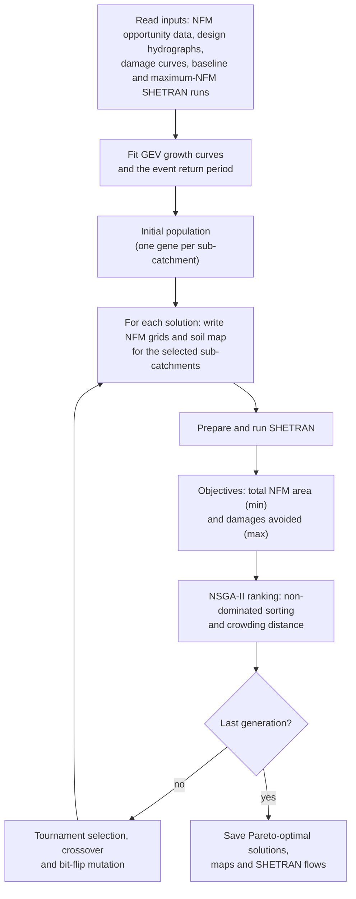

# RAINS

**Resilient & Affordable Implementation of Natural flood management using SHETRAN**

[](https://github.com/asidurrehman/RAINS/actions/workflows/tests.yml)
[](LICENSE)
[](https://www.python.org/)

This set of Python scripts integrates the SHETRAN hydrological model with a
Non-dominated Sorting Genetic Algorithm II (NSGA-II) to optimise the location
and combined sizing of various Natural Flood Management (NFM) features.

---

## Contents

- [Overview](#overview)
- [How it works](#how-it-works)
- [Repository structure](#repository-structure)
- [Requirements](#requirements)
- [Installation](#installation)
- [Input data and folder layout](#input-data-and-folder-layout)
- [Configuration](#configuration)
- [Usage](#usage)
- [Outputs](#outputs)
- [Running the tests](#running-the-tests)
- [Citation](#citation)
- [Licence](#licence)
- [Acknowledgements](#acknowledgements)
- [Contact](#contact)

## Overview

RAINS searches for the sub-catchments where NFM should be implemented to get
the best trade-off between two objectives:

| Objective | Direction | Unit |
|---|---|---|
| Total NFM area | minimise | km² |
| Flood damages avoided for communities at risk | maximise | £ million |

Each candidate solution is a binary chromosome with one gene per SHETRAN
sub-catchment: `1` means NFM is implemented in that sub-catchment, `0` means it
is not. Three NFM types are applied together wherever a gene is `1`:

- **Runoff attenuation features (RAFs)** – additional storage,
- **Woodland**,
- **Improved grassland / soil**.

The code is set up for the River Irwell to Bury Bridge (SHETRAN 200 m model)
and evaluates a flood event that peaked on 9 October 1983.

## How it works



**1. Preparation (once per run)**

- The NFM layers chosen in `config.yaml` are summed to give the total NFM
  storage available in each Water Framework Directive (WFD) catchment.
- For every community at risk, design-hydrograph volumes are calculated for the
  5, 20, 50, 100 and 200-year return periods, and the maximum NFM storage
  available to the community is estimated from its catchment area (FEH data)
  as a share of the WFD catchment.
- A GEV distribution is fitted to the annual maxima of a long baseline SHETRAN
  simulation (1980–2014) to find the return period of the modelled event, and
  flow growth curves are built for every river link from the long baseline
  and maximum-NFM simulations.

**2. Evaluating one solution** (`shetran_sim` in `rains_main.py`)

1. The maximum storage (RAF) and woodland grids are set to zero in the
   sub-catchments without NFM; improved-soil cells in the selected
   sub-catchments become a new soil type in the soil map.
2. SHETRAN is prepared (`shetran-prepare-snow-NFM.exe` with the library file),
   the rundata file is pointed at the discharge-points and initial-conditions
   files, the vsd file is set to use those initial conditions (INITYP = 2), and
   `shetran.exe` is run. Fortran pauses and errors are skipped so that one
   failed simulation does not stop the optimisation.
3. **Damages avoided:** the simulated event-day flow at each river link is
   placed between the baseline and maximum-NFM event flows. That fraction
   scales the growth curves, giving flow-reduction factors for each return
   period. These are applied to the design-hydrograph volumes to give the
   volume attenuated for each community, which is expressed as a fraction of
   the community's maximum NFM storage (0–1, rounded to 0.01) and converted
   into damages avoided with that community's volume–damage curve. The values
   are summed over all communities.
4. **NFM area:** the RAF, woodland and improved-soil areas of the selected
   sub-catchments are summed.

**3. NSGA-II**

- The initial population contains a no-NFM solution, an NFM-everywhere
  solution and random unique solutions.
- Parents are chosen by binary tournament; children are created by
  single-point crossover and bit-flip mutation (probability 0.4).
- Offspring that have already been simulated are discarded, so no solution is
  simulated twice.
- Parents and offspring are ranked together by non-dominated sorting and
  crowding distance, and the best `pop_size` solutions form the next
  generation. The run lasts 100 generations.
- Finally the Pareto-optimal solutions of the last generation are saved and
  simulated once more to keep their SHETRAN flow files.

## Repository structure

```
RAINS/
├── rains_main.py                         # Main script: runs the optimisation
├── rains_all_functions.py                # NSGA-II operators, NFM grid editing, plots
├── SHETRAN_Post_Simulation_Functions.py  # General SHETRAN helper functions
├── config.yaml                           # Root folder and run settings
├── version.py                            # Version number
├── tests/                                # Automated tests (no SHETRAN needed)
├── .github/workflows/tests.yml           # Runs the tests on GitHub
├── requirements.txt                      # pip dependencies
├── environment.yaml                      # conda environment
├── pyproject.toml                        # Project metadata and tool settings
├── CITATION.cff                          # Citation metadata
├── CHANGELOG.md
└── LICENSE                               # GNU GPL v3.0
```

## Requirements

- **Python 3.10 or newer** and the packages in [`requirements.txt`](requirements.txt)
  (numpy, pandas 2.2–2.x, geopandas, rasterio, scipy, matplotlib, openpyxl,
  plotly, hydroeval, PyYAML).
- **SHETRAN** – not included. RAINS calls `shetran-prepare-snow-NFM.exe` and
  `shetran.exe`, so it needs a SHETRAN build whose prepare program supports the
  NFM input grids. See the [SHETRAN website](https://research.ncl.ac.uk/shetran/).
- **Windows** for a full optimisation run: the SHETRAN programs are Windows
  executables and the file handling in `shetran_sim` assumes Windows paths.
  The tests run on any operating system.
- **Catchment data** – the input files listed below (not included).

## Installation

```bash
git clone https://github.com/asidurrehman/RAINS.git
cd RAINS
```

With conda:

```bash
conda env create -f environment.yaml
conda activate rains
```

Or with pip in a virtual environment:

```bash
python -m venv .venv
.venv\Scripts\activate          # Windows  (macOS/Linux: source .venv/bin/activate)
pip install -r requirements.txt
```

## Input data and folder layout

All inputs are read from the **root folder** set in `config.yaml`
(default `C:/z_nfm_opt`). The scripts themselves can stay in this repository.

```
<root>/
├── 04_irwell_notebook_data/
│   ├── a0000002b.gdbtable                              NFM opportunity polygons (File Geodatabase table)
│   ├── Calculated_Hydrographs.p                        Design hydrographs (pickled GeoDataFrame)
│   ├── FEH_Data.xlsx                                   FEH catchment descriptors
│   ├── CaR_name_ID_Final.csv                           Communities at risk
│   ├── vol_damage_curves.pkl                           Volume attenuated vs damages avoided
│   ├── Irwell_to_Bury_Bridge_200m_discharge_baseline_long.txt     SHETRAN, 1980-01-01 to 2014-12-30
│   ├── Irwell_to_Bury_Bridge_200m_discharge_max_nfm_long.txt      SHETRAN, 1980-01-01 to 2014-12-30
│   ├── Irwell_to_Bury_Bridge_200m_discharge_baseline_event.txt    SHETRAN, 1983-10-03 to 1983-10-12
│   └── Irwell_to_Bury_Bridge_200m_discharge_max_nfm_event.txt     SHETRAN, 1983-10-03 to 1983-10-12
├── 05_inputs_backup/
│   ├── Irwell_to_Bury_Bridge_200m_PET.csv              Original PET file
│   └── Irwell_to_Bury_Bridge_200m_Soil.asc             Original soil-category grid
├── 10_nfm_backup/
│   ├── Irwell_to_Bury_Bridge_200m_NFM_storage.asc      Maximum RAF storage grid
│   ├── Irwell_to_Bury_Bridge_200m_NFM_woodland.asc     Maximum woodland grid
│   └── Irwell_to_Bury_Bridge_200m_Improved_Soil.asc    Maximum improved-soil grid
├── 15_shapefiles/
│   ├── ui_shetran_sub_catchments.shp (+ .dbf, .shx, .prj)          Sub-catchments (decision variables)
│   └── ui_shetran_sub_catchments_smooth.shp (+ .dbf, .shx, .prj)   Smoothed sub-catchments for maps
├── 20_shetran_easy_setup_snow/
│   ├── shetran-prepare-snow-NFM.exe
│   └── shetran.exe
├── 25_opt_outputs/                                     Output folder (create before running)
├── Irwell_to_Bury_Bridge_200m_LibraryFile.xml          SHETRAN library file (+ the inputs it references)
├── Irwell_to_Bury_Bridge_200m_discharge_points.txt     Multi-point discharge extraction file
└── input_Irwell_to_Bury_Bridge_200m_vsi.txt            Subsurface initial conditions
```

Fields and columns used by the code:

| File | Used fields / columns |
|---|---|
| `a0000002b.gdbtable` | `Workshop_WfW_Area_km2`, `Workshop_CombLoss_Area_km2`, `Workshop_ImpGrass_Area_km2`, `Extra_Pond_Capacity_RP100_10`, `Area_km2` |
| `Calculated_Hydrographs.p` | `Unique_ID`, `RP` (`RP2` … `RP200`), `timestep` (hours, 0.1 h steps), `QT`, `SnappedX`, `SnappedY`, point geometry |
| `FEH_Data.xlsx` | `X`, `Y`, `AREA` |
| `CaR_name_ID_Final.csv` | `property_report_name`, `jacobs_storage_tool_ID` (one ID or several separated by `/`), `SHETRAN_id` |
| `vol_damage_curves.pkl` | One column per community (`property_report_name`), 100 rows for attenuated fractions 0.01–1.00 |
| `ui_shetran_sub_catchments.shp` | `opt_id` (0 … n−1, one per gene), `raf`, `woodland`, `imp_soil` (areas in m²) |
| `ui_shetran_sub_catchments_smooth.shp` | `opt_id` |

During each simulation RAINS writes the SHETRAN input files it changes into
the root folder (`Irwell_to_Bury_Bridge_200m_PET.csv`, `..._NFM_storage.asc`,
`..._NFM_woodland.asc`, `..._Soil.asc`) and SHETRAN writes
`output_Irwell_to_Bury_Bridge_200m_discharge_sim_regulartimestep.txt` there.
The rundata and vsd files are created by the SHETRAN prepare program.

## Configuration

Settings are read from [`config.yaml`](config.yaml) next to `rains_main.py`.
The defaults reproduce the original set-up.

| Key | Default | Meaning |
|---|---|---|
| `root` | `C:/z_nfm_opt` | Root (working) folder described above |
| `NFM_features_to_include` | `Extra_Pond_Capacity_RP100_10`, `WfW`, `ImpGrass` | NFM layers summed for the WFD storage estimate (`Losses` is also available) |
| `pop_size` | `100` | Number of solutions per generation |

Event-specific settings are still set in `rains_main.py`: the number of
generations (`range(1, 101)`), the mutation probability (`p = 0.4`), the event
date (`'1983-10-09'`, also inside `shetran_sim`), the simulation periods
passed to `read_shetran` / `get_growth_curves`, and the plot axis limits.

## Usage

1. Prepare the root folder as described above and create `<root>/25_opt_outputs`.
2. Set `root` (and any other values) in `config.yaml`.
3. Run the optimisation:
   - **Spyder:** open `rains_main.py` and press *Run file* (F5).
   - **Terminal:**
     ```bash
     python rains_main.py                         # uses config.yaml
     python rains_main.py --config my_run.yaml    # uses another configuration file
     ```

A full run performs up to `pop_size` × 101 SHETRAN simulations (initial
population plus 100 generations), plus one per Pareto-optimal solution at the
end. Before starting a new run, delete or empty
`<root>/25_opt_outputs/opt_flows` from any previous run.

## Outputs

Written to `<root>/25_opt_outputs/`:

| File | Content |
|---|---|
| `Generation_No_<n>.png` | Objective scatter plot and sub-catchment contribution map for generation *n* (0 = initial population) |
| `Generation_No_100_optimal.png` | The same for the Pareto-optimal solutions of the last generation |
| `simulated_data.csv` | Every solution simulated |
| `generation_data.csv` | The population kept in every generation |
| `final_generation_optimal_data.csv` | Pareto-optimal solutions of the last generation |
| `catchments_contribution_to_optimised_solutions.csv` | How often each sub-catchment is selected in the optimal solutions (`cat_id`, `count`, `percent_count`) |
| `opt_flows/Chromosome_XXX.txt` | SHETRAN discharge output for each Pareto-optimal solution |

The solution tables have the columns `SN`, `Generation`,
`Catchment_0` … `Catchment_<n-1>` (the genes), `RAFs_total_area`,
`Woodland_total_area`, `Imp_grassland_total_area`, `All_total_area` (km²)
and `Damage_avoided` (£ million).

## Running the tests

The tests use small synthetic files, so SHETRAN and the catchment data are not
needed:

```bash
pip install pytest
pytest
```

They also run automatically on GitHub for every push and pull request
(Ubuntu and Windows, Python 3.10 and 3.12).

## Citation

If you use RAINS, please cite the software. GitHub's **"Cite this repository"**
button (from [`CITATION.cff`](CITATION.cff)) provides APA and BibTeX formats.

> Ur Rehman, A., Lewis, E., Smith, B., & Birkinshaw, S. (2025). *RAINS:
> Resilient & Affordable Implementation of Natural flood management using
> SHETRAN* (Version 1.0.0) [Computer software].
> https://github.com/asidurrehman/RAINS

```bibtex
@software{rains,
  author  = {Ur Rehman, Asid and Lewis, Elizabeth and Smith, Ben and Birkinshaw, Steve},
  title   = {{RAINS}: Resilient \& Affordable Implementation of Natural flood management using {SHETRAN}},
  year    = {2025},
  version = {1.0.0},
  url     = {https://github.com/asidurrehman/RAINS}
}
```

## Licence

Asid Ur Rehman, Elizabeth Lewis, Ben Smith, Steve Birkinshaw (C) 2025.
Licenced under the terms of the GNU General Public License v3.0 – see
[`LICENSE`](LICENSE).

## Acknowledgements

RAINS was developed at Newcastle University and the University of Manchester.
`SHETRAN_Post_Simulation_Functions.py` was written by Ben Smith; newer versions
of some of its functions are available in
[SHETRAN-python-optimiser](https://github.com/DrBenSmith/SHETRAN-python-optimiser).

## Contact

Questions, bug reports and suggestions are welcome as
[GitHub issues](https://github.com/asidurrehman/RAINS/issues).
